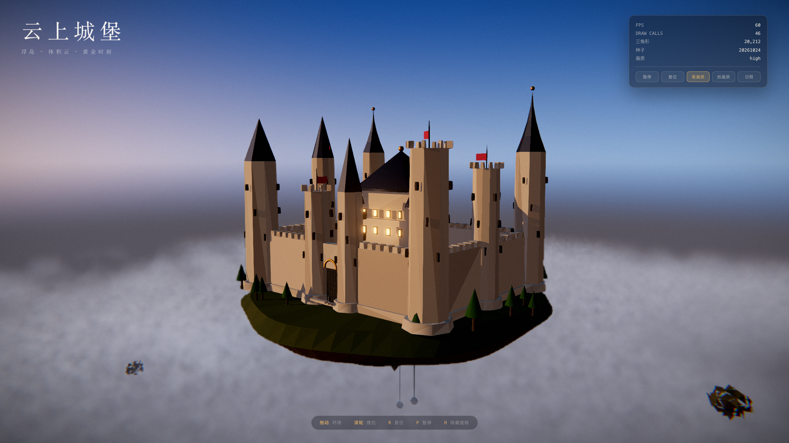

# 云上城堡 · Cloud Castle

一座漂浮在云海之上的实时 Three.js 城堡。全部几何、材质、云层、天空都由代码程序化生成，
**运行时零外部资源、零外站请求**——打开页面不下载任何模型、贴图、HDRI 或字体。



## 特性

- **程序化浮岛与城堡**：8 座高低不一的塔楼（八角/十二角、锥顶/尖顶/平顶女墙三种屋型）、
  连续城墙（按塔身裁切拼合，正门留真实门洞）、城垛、拱门、闸门铁栏、发光窗、主堡与角楼、
  旗帜。同一颗种子永远生成同一座城。
- **体积云**：半分辨率 raymarch，3D 噪声纹理驱动，Beer–Lambert 透射率 + 双瓣 Henyey–Greenstein
  相函数 + 向阳光方向的光步进自阴影 + Beer–Powder 边缘衰减 + 高度包络与边缘侵蚀。
  云层按场景深度截断，因此云不会糊在塔尖前面。
- **线性 HDR 全流程**：场景与云都渲进 half-float 线性缓冲，辉光 / 抗锯齿 / 色调映射 /
  收尾分级依次串联，ACES 只映射一次。
- **自写大气天穹**：天顶蓝、地平线暖带、太阳本体与辉光全部在线性辐射度空间计算，
  因此 Bloom 只咬住真正的光源。
- **交互**：拖动环绕、滚轮推拉、`R` 复位、`P` 暂停、`H` 隐藏面板，另有日照与画质切换。
- **调试面板**：实时显示 FPS、draw calls、三角形数、种子与画质。

## 运行

```bash
npm ci
npm run dev          # 开发服务器 http://127.0.0.1:5173
```

构建与预览（生产构建，截图与测试都基于它）：

```bash
npm run build
npm run preview -- --host 127.0.0.1 --port 4173 --strictPort
```

## 测试

```bash
npm test             # = npm run build && node --test tests/unit/*.test.js tests/browser/*.test.js
npm run test:unit    # 纯 Node 单元测试
npm run test:browser # 构建 + 真实 Chrome 端到端验收（含截图与量化指标）
```

`npm run test:browser` 会自行拉起 `vite preview`、用本机已安装的 Google Chrome 跑一遍真实渲染，
断言无 console 错误、无未捕获异常、**零外站请求**，采集 60 个不同渲染帧的 draw calls / 三角形数，
并在 `reports/screenshots/` 产出三张真实截图、在 `reports/browser-metrics.json` 落量化指标。

> 需要 WebGL2。本机 Chrome 已安装即可，测试不下载 Playwright 自带的浏览器内核。

## 查询参数

| 参数 | 取值 | 说明 |
|---|---|---|
| `seed` | `0` – `4294967295` | 程序化生成的种子，决定城堡与浮岛形态。默认 `20261024` |
| `quality` | `high` / `low` | 画质档位（云的步进数、分辨率、阴影采样数）。默认 `high` |
| `still` | `1` | 冻结时间与运镜，用于可复现截图 |
| `debug` | 逗号分隔 | 调试开关，见下 |

调试开关：`nocloud`、`nosky`、`nobloom`、`nosmaa`、`nofilm`、`nooutput`、`nopost`、
`debugdepth`（显示深度缓冲）、`debugcloud`（显示云 RT 原值）、`onlysky`（只留天穹）。

例：`?seed=7&quality=low&still=1&debug=nocloud`

## 项目结构

```
index.html            入口
src/main.js           启动、主循环、window.__CLOUDCASTLE__ 测试门面
src/config.js         URL 参数解析与画质预设
src/lib/prng.js       mulberry32 确定性随机源
src/lib/metrics.js    渲染指标（draw calls / 三角形 / FPS）
src/scene/            城堡模型、几何、材质、浮岛、天空、云噪声、世界装配
src/camera/           轨道相机与开场运镜
src/render/           HDR 管线、体积云 Pass、收尾胶片 Pass
src/shaders/          GLSL（天空、体积云、云合成、胶片）
src/ui/panel.js       HUD 面板
tests/unit/           纯 Node 单元测试
tests/browser/        真实 Chrome 端到端验收
reports/              执行报告、测试日志、量化指标、截图
```

## 不在本轮范围

后端与存档、WebGPU、移动端触控手势、外部素材（模型 / 贴图 / HDRI / 字体）、CDN、
音频与游戏系统、CI / PR 流程。云层是实时近似（Beer–Lambert + 双瓣相函数），
不是完整大气多次散射模拟。

## 许可

本仓库代码可自由用于学习与演示。
